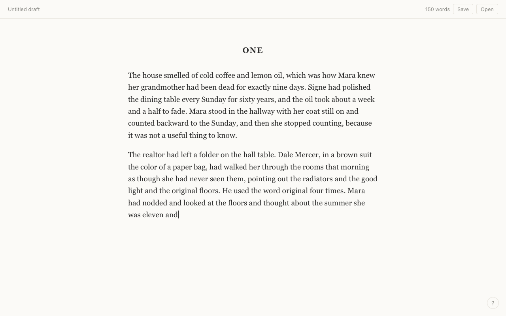
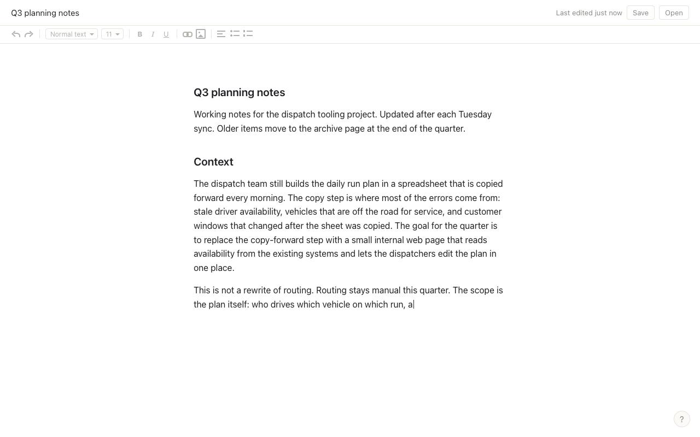

# Cover Story

A single static web page where typing anything makes the screen show a plausible document being written, while the real keystrokes go into a hidden buffer. Hold a key to peek at what you actually wrote, copy it, clear it, or save it as a password-protected file.

Nothing you type leaves this page. There is no server-side code, no account, no analytics and no third-party script. The page's own Content Security Policy (`default-src 'none'`) makes the browser refuse any fetch, XHR, beacon or web socket, so even a bug could not send anything. The only requests the page makes are for its own two files, `index.html` and `covers/<id>.js`, from the same origin, and neither carries anything you type.

Live: https://cover-story-taupe.vercel.app

Demo GIF: not recorded yet. (Pranav: record a 10 to 15 second screen capture of typing, holding Cmd to peek, and pressing Esc, convert it to a GIF, save it as `docs/demo.gif`, add the image here, and delete this paragraph.)

## The three versions

Pick one on the intro screen. The choice is remembered in your browser.

### 1. A novel

Serif type on a paper background, a 680px measure, chapter headings, and a header that reads "Untitled draft" with a live word count. The word count counts the cover text on screen, never your real text. The cover text is an original short story of about 1,760 words that loops with a paragraph break when it runs out.



### 2. A work document

Looks like a modern document editor: sans-serif type, a narrower measure, a document title ("Q3 planning notes"), a thin toolbar of greyed icon placeholders drawn in CSS that do nothing, and "Last edited just now" on the right. That text is decorative and never changes. The cover text is about 1,280 words of ordinary internal project notes for a fictional company, with short headings, bullet lists, action items with invented owners and a decisions section.



### 3. A research paper

Looks like a manuscript: an academic serif on a white sheet, a title block with a fictional title, author and affiliation, numbered sections (Abstract, 1. Introduction, 2. Method, 3. Results, 4. Discussion) and a reference list. The header shows "Page 1 of 1", which is decorative. Citations in the text look like [1] and are plain text. The cover text is about 1,630 words on a deliberately bland topic, and every citation in it is fictional.


## Controls

| Action | How |
|---|---|
| Write | Type. Each printable key, Enter and Tab is recorded in the hidden buffer and reveals one more character of the cover. Backspace removes one from both. |
| Peek | Hold Ctrl (Cmd on a Mac) for 900 ms. The cover disappears and your real text is shown. Release the key, or switch windows, and it is hidden again. |
| Copy | While peeking, press Ctrl+C (Cmd+C). Your real text goes to the clipboard. |
| Clear | Press Esc. Both the hidden buffer and the screen are erased. The page also clears itself if its tab has been hidden for more than 10 minutes while the buffer is non-empty. |
| Save | The Save button asks for a password and downloads a `.cover` file. |
| Open | The Open button reads a `.cover` file, asks for its password and replaces the hidden buffer with its contents. The screen is rebuilt to the same length. |
| Help | The `?` button at the bottom right brings the intro screen back, with the version picker and the custom cover text box. |

Keys pressed with Ctrl, Cmd or Alt held are left to the browser and not recorded, except Ctrl+C while peeking. Shift+Tab is left to the browser too, so keyboard users can reach the buttons (Safari skips buttons by default, so there it is Option+Shift+Tab). Keyboard events with `isComposing` set (input method editors) are ignored. Reloading or closing the tab erases the hidden buffer; if it is not empty, the browser shows its standard "leave page" prompt first.

## How it works

Everything is in `index.html` (the engine, the styles and the intro) plus one ES module per cover in `covers/`. There is no framework, no build step and no runtime dependency. The only development dependency is jsdom, for the tests.

- A `keydown` listener on `document` handles every key. Printable keys are `preventDefault`ed, appended to a string that lives in a closure, and advance a cursor one character through the cover text.
- The cover is rendered one character per keystroke into paragraphs. A cover line that starts with `## ` becomes a heading, a line that starts with `- ` becomes a bullet in a list, and a line that starts with `[n] ` is typed as text but styled as a reference entry. The markers themselves cost no keystrokes.
- About 3.5 percent of the time, at the start of a word, the cover shows a wrong neighbouring key instead of the right letter; the next keystroke removes it. It costs one keystroke and looks like a person correcting a typo. The keystroke right after a correction never produces another one.
- When the cover text runs out, the page inserts a paragraph break and starts the text again from the top.
- The hidden buffer is written into the page only while peeking and is removed again when peeking ends. The page's small console object (`window.CoverStory`) exists for the cover loader and the tests; it returns the cover id and text and nothing that touches the hidden buffer, encrypted or not. Any script that runs inside the page could still capture keystrokes directly, which is the extension and malware caveat below.
- Covers are loaded with a dynamic `import('./covers/<id>.js')` from a small module script, so the page must be served over http. Opened directly from a file, the browser blocks the import and the page shows a notice saying so.
- `localStorage` holds three things only: whether you have seen the intro, which cover you picked, and any custom cover text you pasted. It never holds the hidden buffer.

### Save file format

Save encrypts the hidden buffer with AES-256-GCM. The key is derived from your password with PBKDF2 (SHA-256, 310,000 iterations, a random 16-byte salt) and the cipher uses a random 12-byte IV, all through the browser's WebCrypto API. The downloaded `.cover` file is JSON:

```json
{
  "format": "cover-story",
  "version": 1,
  "cipher": "AES-256-GCM",
  "kdf": "PBKDF2-SHA-256",
  "iterations": 310000,
  "salt": "<base64, 16 bytes>",
  "iv": "<base64, 12 bytes>",
  "data": "<base64, ciphertext plus the 16-byte authentication tag>"
}
```

Open checks the shape of the file, refuses an iteration count above 2,000,000 (so a crafted file cannot hang the tab), derives the key and decrypts. A wrong password or a damaged file fails with the toast "Wrong password or damaged file" and nothing else changes. Those are the parameters; judge them for yourself. There is no password recovery.

## Threat model

What it helps with:

- A casual onlooker who can see your screen sees a document being written, not your text. The tab title, the header and the typing rhythm all fit the cover.
- Walking away from the machine with the tab in the background: the page clears itself after 10 minutes hidden. (If the tab stays in the foreground, nothing clears on its own. Press Esc.)
- Someone who finds a saved `.cover` file without the password gets the ciphertext and a rough idea of its length, nothing else.
- Network observers: nothing is sent anywhere, and the page's Content Security Policy makes the browser enforce that.

What it does not protect against:

- Onlookers reading your fingers or lips, or a camera pointed at the keyboard.
- Anyone who can see the screen while you are peeking, or who looks at your clipboard after you copy.
- A compromised machine. Malware, a hardware or software keylogger, or screen recording captures keystrokes and pixels before the page ever sees them.
- Browser extensions. An extension with access to the page can read its DOM and JavaScript state, including the hidden buffer.
- Corporate monitoring: endpoint agents, managed browsers, data loss prevention tools and screen recording all sit outside the page.
- A forgotten password. The file cannot be opened without it.
- The browser's own memory. While the page is open, the plain text is in the browser's memory, and a crash dump or swap file could hold it.

Corporate IT may treat a page like this as an exfiltration or monitoring-evasion tool. Using it on a managed machine may break policy regardless of what you type. It exists to demonstrate a client-side technique and an honest threat model, not to defeat an employer's monitoring.

## Known limitations

- No mobile support. Virtual keyboards do not reliably fire `keydown` events, so typing on a phone or tablet does not work. The layout does not overflow at phone widths, but the page is a desktop tool.
- Only key presses are recorded. Text that arrives another way, such as a paste, drag and drop, dictation or the composed text of an input method editor, is neither recorded nor shown.
- Characters that need Alt, Option or AltGr on your keyboard layout (for example @ or { on many non-US layouts, or accented letters typed with Option on a Mac) are passed to the browser and not recorded, because every Alt chord is left alone.
- The page has to be served over http (see "Run locally"). Opening `index.html` directly shows a notice instead of a cover.
- Peek and copy use keyboard modifiers, so they do not work from a touch screen.
- Tested headless in Chromium and in WebKit (Safari's engine): no console errors, all three covers, peek timing, save and open, and no horizontal overflow at 390px. Current Firefox and Edge use the same standard APIs (WebCrypto, ES modules, the Clipboard API with a fallback) and are expected to work, but they have not been checked here.

## Run locally

```
git clone https://github.com/PranavOngole/cover-story.git
cd cover-story
npx serve .
```

Then open http://localhost:3000. Any static file server works; the page needs http only so the browser will import the cover modules.

To run the tests:

```
npm install
npm test
```

The suite (`tests/smoke.mjs`) loads the real `index.html` in jsdom and drives it through keyboard events, the dialogs, the download path and the console object: cover rendering, the hidden buffer, peek timing, copy, Backspace, Esc, the 10-minute wipe, the three covers, bullets, headings, references, and save and open with right and wrong passwords. It exits non-zero on any failure. jsdom does not run module scripts, so the suite imports the cover files itself and hands them to the page the same way the module loader does.

## Deployment

The site is deployed with the Vercel CLI (`vercel --prod`) as plain static files with no framework and no build step. `.vercelignore` keeps the deployment to `index.html` and `covers/`.

## Fictional content

All cover text is original prose written for this project. The people, places and events in the story, the company, project, owners, dates and figures in the work notes, and the study, region, figures, authors, affiliation and every reference in the paper are fictional. None of the cited papers exist. The author name and affiliation in the paper's title block are placeholders.

## License

MIT. See `LICENSE`.
